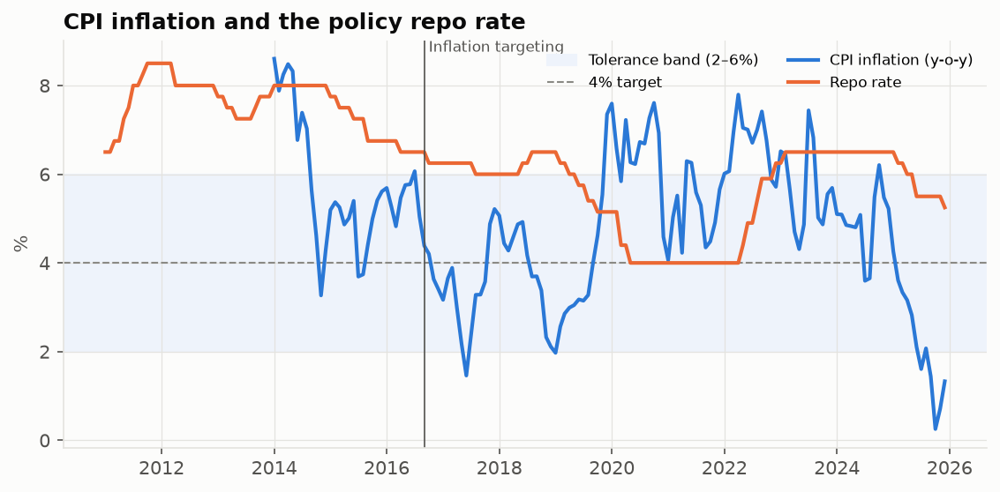

# Forecasting India's CPI Inflation and Monetary Policy Transmission

An applied econometrics and time-series project on Indian macro data from
RBI DBIE and MoSPI. It asks two questions:

1. **How well can India's CPI inflation be forecast 1, 3 and 12 months ahead?**
   Do a VAR or machine-learning models beat a well-specified SARIMA and a naive
   random walk?
2. **How does monetary policy pass through to the economy?** What happens to
   inflation, bank credit growth and industrial output after a 100 bp repo
   rate increase?

The results are published as an interactive Streamlit dashboard.

> Live app: https://inflationforecasting.streamlit.app



## What is in it

| Step | Method | Code |
|---|---|---|
| Data pipeline | Mixed-frequency cleaning (fortnightly credit, daily rates to monthly), y-o-y transforms, base-year splicing, STL seasonal adjustment, HP-filter output gap | `src/inflation_fc/data.py` |
| Stationarity | ADF, KPSS, Zivot-Andrews (unknown structural break) | `stationarity.py` |
| Regression | Open-economy Phillips curve and Taylor rule with interest-rate smoothing; OLS with Newey-West HAC errors; Breusch-Godfrey, Breusch-Pagan, Jarque-Bera, VIF; Chow test at the 2016 move to inflation targeting; pre/post-2016 subsamples | `regression.py` |
| Univariate model | Box-Jenkins SARIMA on log CPI: grid search, Ljung-Box residual check, BIC | `sarima.py` |
| Multivariate model | VAR with lag selection, Granger causality, Cholesky impulse responses with Monte Carlo bands, variance decomposition, stability check | `var_model.py` |
| ML baseline | Random forest and gradient boosting, direct multi-horizon setup, no-look-ahead training, base-effect feature | `ml_models.py` |
| Evaluation | Rolling-origin (expanding window) backtest, RMSE/MAE, Diebold-Mariano tests with Harvey-Leybourne-Newbold correction, with and without COVID months | `evaluate.py` |
| R replication | Stationarity tests, Phillips curve with Newey-West errors, SARIMA and VAR re-estimated in R | `r/replication.R` |
| Dashboard | Streamlit + Plotly, 7 tabs | `streamlit_app.py` |

## Data

Monthly, 2012 to the latest release. Full instructions are in
[`data/SOURCES.md`](data/SOURCES.md).

| Series | Source |
|---|---|
| CPI Combined, all-India general index (2012=100) | MoSPI / RBI DBIE |
| Policy repo rate | RBI (DBIE, policy press releases) |
| Scheduled commercial banks' non-food credit | RBI DBIE |
| Index of Industrial Production | MoSPI |
| INR/USD exchange rate | RBI reference rate / FRED |
| Brent crude oil price | FRED (IMF) |

## How to run it

Use Python 3.10 or newer.

```bash
python -m venv .venv
source .venv/bin/activate          # Windows: .venv\Scripts\activate
pip install -r requirements.txt

# 0. Optional: check everything works on synthetic data first (about 5 minutes)
python scripts/run_all.py --demo --quick
streamlit run streamlit_app.py

# 1. Get the data
python scripts/fetch_data.py       # downloads oil, INR/USD (+ fallbacks) from FRED
#    then add the official CPI, IIP and credit files from MoSPI / DBIE (see data/SOURCES.md)
#    and check data/raw/repo_rate.csv has every decision up to today

# 2. Run every model, test and backtest (about 5-10 minutes; --quick for ~2 minutes)
python scripts/run_all.py

# 3. Open the dashboard
streamlit run streamlit_app.py

# 4. Optional: R replication (needs R with forecast, tseries, urca, vars, lmtest, sandwich, jsonlite)
Rscript r/replication.R

# Tests
pip install pytest && python -m pytest -q
```

After step 2, `reports/results_summary.md` collects every key number in one place.

**Important:** `--demo` data is synthetic. Before you deploy or quote any
number, run `python scripts/run_all.py` without `--demo`. The app shows a
yellow warning banner whenever it is showing demo data.

## Deploying to Streamlit Community Cloud

The app only reads files, so it starts fast and needs no API keys.

1. Run `python scripts/run_all.py` on real data locally.
2. Commit everything, **including** `data/processed/` and `results/` (the app
   reads them), and push to a public GitHub repo.
3. Go to [share.streamlit.io](https://share.streamlit.io), choose "Create app",
   pick the repo and branch, and set the main file to `streamlit_app.py`.
4. When new CPI data comes out, add it to `data/raw/`, re-run
   `run_all.py`, and push. The app redeploys automatically.

## Repository structure

```
├── streamlit_app.py           # dashboard
├── requirements.txt
├── data/
│   ├── raw/                   # source files (date,value CSVs); repo_rate.csv included
│   ├── processed/             # model-ready monthly panel + source log
│   └── SOURCES.md             # where every series comes from
├── src/inflation_fc/
│   ├── config.py              # all settings in one place
│   ├── data.py                # loading, FRED download, splicing, transforms
│   ├── stationarity.py
│   ├── regression.py          # Phillips curve, Taylor rule, diagnostics, Chow test
│   ├── sarima.py              # SARIMA + random walk + seasonal average benchmarks
│   ├── var_model.py           # VAR, Granger, IRF, FEVD
│   ├── ml_models.py           # random forest, gradient boosting
│   ├── evaluate.py            # rolling backtest, RMSE/MAE, Diebold-Mariano
│   ├── plots.py, style.py     # static figures, shared colours
├── scripts/
│   ├── fetch_data.py          # automatic downloads
│   ├── run_all.py             # full pipeline
│   ├── make_summary.py        # results_summary.md with filled-in numbers
│   └── make_demo_data.py      # synthetic data for testing only
├── notebooks/walkthrough.ipynb  # step-by-step tour of the analysis
├── r/replication.R
├── reports/
│   ├── figures/
│   └── results_summary.md     # generated
├── results/                   # generated tables read by the app
└── tests/
```

## Methodological choices (and why)

* **SARIMA is fitted to log CPI, not to y-o-y inflation.** The index carries
  the monthly seasonal pattern (vegetable prices peak in July to October), and
  forecasting the index then converting gives a consistent y-o-y forecast.
* **A seasonal-naive benchmark would be useless here.** Repeating last
  year's m-o-m changes gives exactly the random walk for y-o-y inflation at
  horizons up to 12 months, so the second benchmark averages each calendar
  month's m-o-m change over five years instead.
* **SARIMA order:** among models whose residuals pass the Ljung-Box test,
  the lowest BIC wins. The order is chosen on pre-2018 data only, so the
  backtest does not use information from the future.
* **ML models predict the change in inflation, not its level**, because tree
  models cannot extrapolate. Each horizon has its own model (direct strategy),
  and a *base-effect* feature records the past m-o-m changes that drop out of
  the y-o-y rate. The HP-filter output gap is excluded from ML features because
  it is two-sided and would leak future data.
* **COVID:** dummies in the regressions and VAR. Forecast accuracy is reported
  with and without the March 2020 to September 2021 target months.
* **VAR ordering** (oil → output gap → inflation → repo → credit → INR): oil
  is the most exogenous, policy reacts within the month to output and prices,
  and financial variables react fastest. Results depend on this assumption.
* **The VAR uses the output gap, not IIP y-o-y growth.** IIP growth swung from
  about −57% (April 2020) to +134% (April 2021) purely on base effects, which
  makes VAR forecasts explode. In the backtest the gap is re-estimated at every
  origin from data available at that time (a one-sided, real-time estimate),
  so it does not leak future information. COVID months get one impulse dummy
  each, which removes their influence on the estimated coefficients.

## Limitations

* Uses the latest data vintage, not the real-time data RBI had (CPI and IIP
  are revised), so this is a pseudo out-of-sample exercise.
* The IIP covers only industry (about a quarter of GDP), so the output gap is
  a rough proxy.
* Recursive (Cholesky) identification is simple. Sign restrictions or
  high-frequency identification would be natural extensions.
* The policy repo rate barely moved in 2020-22; the WACR or a shadow rate
  captures the stance better in that period.

## Possible extensions

Food vs core inflation split, a VECM after Johansen tests, Bayesian VAR,
household inflation expectations (RBI survey), and quantile regression for
inflation risk.

## Author

Aryan Bendre · https://www.linkedin.com/in/aryanbendre
